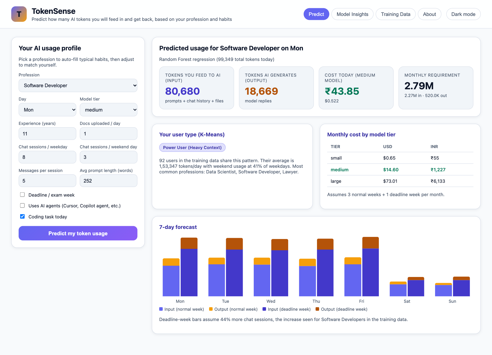

# TokenSense – AI Token Utilization Predictor

**TE-B Machine Learning Mini Project (Experiment 10)**

People use AI assistants (ChatGPT, Claude, Gemini, Cursor, Copilot) every day, and every
message is billed in **tokens**. TokenSense predicts, for one person, how many tokens they will
**feed to the AI** (input: prompts, chat history, uploaded files) and how many the AI will
**generate** (output) per day and per month, based on their profession and habits. It also
estimates the cost and tells the user which type of AI user they are.

[](https://render.com/deploy?repo=https://github.com/jerry5379/tokensense)



**Printable practical file:** `Experiment_10_Mini_Project_TokenSense.docx` (and the same as `.pdf`).

## Algorithms used

| Module | Algorithm | What it does in this project |
|---|---|---|
| M3 | Random Forest (Regression) | Predicts input and output tokens per user per day from profession, day of week, deadline/exam week, sessions, prompt length, documents, agent use and coding work |
| M4 | K-Means | Groups users into 4 usage types: Light/Irregular, Steady 9-to-5, Anytime Learner/Creator, Power User |

## Results

**Random Forest** (200 trees, 80/20 train/test split, 1,800 unseen test rows):

| Target | MAE (tokens) | RMSE | R² |
|---|---|---|---|
| input_tokens | 11,298 | 26,145 | 0.924 |
| output_tokens | 2,116 | 3,557 | 0.906 |
| **overall** | **6,707** | **14,851** | **0.915** |

The top features are chat sessions per day (35%), messages per session (25%), uses AI agents (18%)
and prompt length (17%).

**K-Means** (k = 4, silhouette 0.25):

| User type | Users | Avg tokens/day | Typical professions |
|---|---|---|---|
| Light / Irregular User | 53 | 36,912 | Digital Marketer, Designer, Business Analyst |
| Steady 9-to-5 Professional | 98 | 44,607 | Customer Support, Doctor, Teacher |
| Anytime Learner / Creator | 57 | 88,156 | Student, Researcher, Content Writer |
| Power User (Heavy Context) | 92 | 153,347 | Data Scientist, Software Developer, Lawyer |

## Project structure

```
token_utilization_predication/
├── app.py                     Flask backend (REST API + serves the frontend)
├── src/
│   ├── config.py              Shared constants: features, professions, pricing
│   ├── generate_data.py       Builds the synthetic training dataset
│   ├── train.py               Trains Random Forest + K-Means, saves models and figures
│   └── profiles.py            Turns daily usage into a user profile for K-Means
├── templates/index.html       Frontend page (4 tabs)
├── static/app.js              Frontend logic (calls the API with fetch)
├── static/style.css           Styling
├── static/figures/            Charts generated by train.py (used in report + UI)
├── data/token_usage_daily.csv 9,000 rows: 300 users × 30 days
├── models/                    Saved models + insights.json (metrics)
├── screenshots/               App screenshots used in the document
├── report_build/              Scripts that take screenshots and build the Word document
├── Experiment_10_Mini_Project_TokenSense.docx / .pdf   Printable practical file
├── REPORT.md                  2-page write-up for the practical file
└── requirements.txt
```

## How to run

```bash
cd token_utilization_predication
python3 -m venv .venv
source .venv/bin/activate          # Windows: .venv\Scripts\activate
pip install -r requirements.txt

python src/generate_data.py        # 1. create data/token_usage_daily.csv
python src/train.py                # 2. train both models (~10 s)
python app.py                      # 3. open http://127.0.0.1:5050
```

The data and trained models are already included, so you can jump straight to step 3.

## Hosting online (Render, free)

`render.yaml` describes the service. Click the **Deploy to Render** button above, sign in with
GitHub and press **Apply**. Render installs the requirements, retrains the models (so they match its
library versions) and serves the app with gunicorn at `https://tokensense-xxxx.onrender.com`.
On the free plan the app sleeps after 15 minutes without visitors; the first visit after that takes
about a minute to wake it up.

## Rebuilding the practical file

If you change the model or the app, regenerate the screenshots and the Word document:

```bash
pip install playwright                          # uses your installed Chrome/Brave, no extra download
python report_build/screenshots.py              # saves screenshots/01..05 (light theme)
cd report_build && npm install docx && cd ..
NODE_PATH=report_build/node_modules node report_build/build_report.js
```

## Using the app

The **Light mode** button in the header switches to a print-friendly theme.


- **Predict:** pick a profession (the form auto-fills typical habits for it), adjust the numbers and press
  *Predict*. You get today's input and output tokens and their cost, the monthly requirement, the monthly cost
  on small, medium and large models, your K-Means user type, and a 7-day forecast for a normal week and a
  deadline week.
- **Model Insights:** Random Forest test results, feature importance, the K-Means clusters and all training charts.
- **Training Data:** a sample of the CSV file and summary statistics.
- **About:** the algorithm table and the architecture diagram.

## API

| Method | Endpoint | Purpose |
|---|---|---|
| GET | `/api/meta` | Dropdown values and typical habits per profession |
| POST | `/api/predict` | Prediction, weekly/monthly forecast, cost, user type |
| GET | `/api/insights` | Training metrics and clusters |
| GET | `/api/dataset` | Training data preview |

## About the dataset

The data is **synthetic**: it was generated by `src/generate_data.py` (random seed 42), because real per-user
token logs are private. It follows how LLM billing really works:

- 1 word ≈ 1.33 tokens.
- Every message re-sends the full conversation, so input ≈ sessions × messages² × prompt size.
- Each uploaded document adds about 2,500 input tokens; agent mode multiplies input about 2.5×.
- Output depends on the profession.
- Weekends, Fridays and deadline/exam weeks change how many sessions people run.
- Every value gets ±12% random noise.

Prices are illustrative USD per 1M tokens (small 0.15/0.60, medium 3/15, large 15/75, input/output),
converted at ₹84 per dollar. They live in `src/config.py`.
